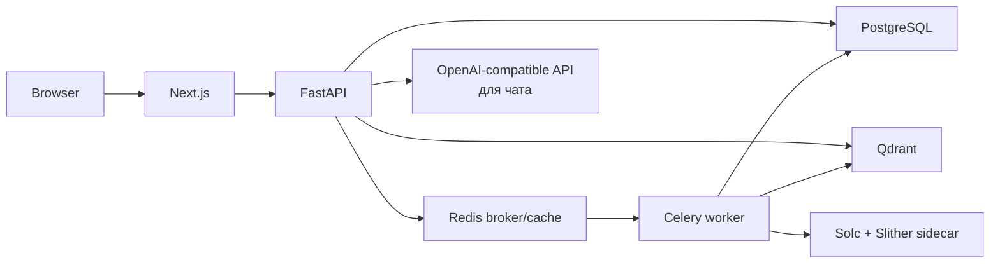

# ChainWise

ChainWise — локальное веб-приложение для предварительного статического анализа Solidity-кода и поиска по его исходникам с цитатами.

## Что делает система

- Принимает `.sol`/`.zip` или загружает верифицированный исходник из поддерживаемого explorer.
- Компилирует allowlisted-версией `solc`, запускает Slither в ограниченном analyzer sidecar и сохраняет результаты.
- Индексирует исходники для поиска и RAG-чата; показывает findings, строки исходника, цитаты и PDF-отчёт.
- Даёт дополнительную оценку A–D: это экспериментальный индикатор предварительной проверки, не вероятность эксплуатации и не аудит безопасности.

## Текущая схема



Поток анализа: загрузка исходника → компиляция AST и Slither findings → embeddings в Qdrant → публикация готового поколения; чат ищет только по этому поколению, затем возвращает ответ с citations.

## Локальный Quickstart

Нужны Docker Compose v2.24+, `make`, Linux x86_64, Python 3.12 и Node.js/npm 20+. Для первой подготовки зависимостей и загрузки базовых Docker-образов требуется интернет. После этого локальные образы собираются без сети: `make deps` заранее подготавливает Python/frontend packages, Slither, allowlisted solc и FastEmbed MiniLM. Перенос подготовленных артефактов между платформами не поддерживается.

```bash
cp .env.example .env
# Задайте локальные SECRET_KEY и POSTGRES_PASSWORD; секреты не коммитьте.
make deps       # первый раз, с интернетом
make up         # сборка и запуск; Compose build network отключён
make health
```

Откройте <http://localhost:3001>, Swagger — <http://localhost:8001/docs>. Compose публикует порты только на loopback; backend и worker находят зависимости по именам Compose-сервисов. `OPENAI_API_KEY` нужен для реального RAG-чата, `ETHERSCAN_API_KEY` — только для загрузки по адресу. Для публичного доступа нужен отдельный HTTPS reverse proxy; см. [эксплуатацию](./docs/operations.md#public-https-entrypoint).

## Безопасное демо без внешних ключей

```bash
make smoke-e2e
```

Это ограниченный **mocked API smoke**, не браузерный live E2E: он загружает синтетический Solidity-контракт, проверяет индексацию, findings, advisory Risk Score, чужой tenant-доступ, цитаты и PDF; компилятор, Slither, Qdrant и LLM подменены заглушками. Используются PostgreSQL и Redis, а записи теста удаляются. Платные LLM credentials и настоящие пользовательские данные не нужны. Опциональный прогон настоящих solc, Slither, FastEmbed и Qdrant описан в [smoke/E2E](./docs/smoke-e2e.md).

## Проверки и CI

GitHub Actions на push и pull request запускает flake8, TypeScript typecheck, frontend tests для polling и Risk Score notice, а также backend pytest с PostgreSQL/Redis. Backend smoke использует заглушки для внешних сервисов; workflow не собирает release images и не выполняет dependency или image vulnerability scan. Команды разработки: `make test`, `make lint`, `cd frontend && npx tsc --noEmit`.

## Ограничения

- Risk Score A–D — эвристически выведенный индикатор предварительной проверки на synthetic labels. Он не является калиброванной вероятностью, не измеряет вероятность эксплуатации и не заменяет независимый аудит. Sensitivity/specificity на реальных контрактах неизвестны; подробности — в [model card](./docs/risk-score-model-card.md).
- Результаты не сертифицированы и не доказывают корректность бизнес-логики или поведение контракта в сети; статический анализ может пропускать проблемы и давать ложные срабатывания.
- Compose production overlay не является готовой production-платформой. В репозитории нет автоматических backup/restore, restore drill, мониторинга/alerting или проверенной процедуры production rollback. Перед реальным deployment выполните [production gate и recovery runbook](./docs/operations.md#production-release-gate).
- Runtime-ограничения analyzer снижают доступ и ресурсы, но не гарантируют защиту от container escape.

## Документация

[Архитектура](./docs/architecture.md) · [Установка](./docs/setup.md) · [Фоновые задачи и решения по восстановлению](./docs/background-jobs.md) · [Эксплуатация](./docs/operations.md) · [Безопасность](./docs/security.md) · [API](./docs/api.md) · [Результаты проверок](./docs/verification-results.md) · [Документация целиком](./docs/README.md)
