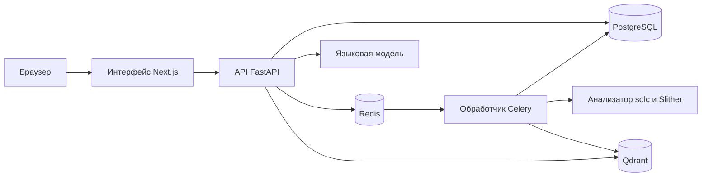

# ChainWise

ChainWise — веб-приложение для статического анализа смарт-контрактов Solidity и поиска ответов по исходному коду с цитатами.

## Что можно сделать

- Загрузка одного файла `.sol`, архива `.zip` с несколькими исходниками или верифицированного кода по адресу контракта.
- Компиляция заранее установленным `solc` и статический анализ Slither.
- Просмотр найденных проблем, исходного кода и экспериментальной оценки A–D.
- RAG-чат: поиск по коду, ответ на вопрос и ссылки на файлы и строки.
- Скачивание PDF-отчёта и история анализов для каждого пользователя.

## Как это работает

Загрузка исходников → компиляция и Slither → разбиение кода на фрагменты → векторизация FastEmbed → сохранение в Qdrant → результаты анализа и чат.



PostgreSQL хранит пользователей, исходники и результаты. Redis обслуживает очередь задач и кеш. Qdrant хранит векторы фрагментов кода; чат использует только успешно завершённое поколение анализа.

## Быстрый старт

Нужны Linux x86_64, Git, Docker с Compose v2.24+, `make`, Python 3.12 с поддержкой `venv`, Node.js 20+ и npm. Скрипты подготовки ожидают команду `python3.12`. Для FastEmbed необходима системная библиотека `libgomp.so.1`.

Первую подготовку выполните с доступом к интернету: скачиваются базовые образы, зависимости, `solc` 0.8.24 и модель MiniLM. Затем образы приложения собираются без сети из подготовленных файлов.

```bash
git clone https://github.com/vladweat/chainwise.git
cd chainwise
cp .env.example .env
```

Задайте в `.env` значения `SECRET_KEY` и `POSTGRES_PASSWORD`, например с помощью `openssl rand -hex 32`. Если нужен настоящий чат, добавьте `OPENAI_API_KEY` до запуска.

```bash
docker compose pull postgres redis qdrant
docker pull python:3.12-slim
docker pull node:20-alpine
make deps
make up
make health
```

Дождитесь запуска сервисов. В ответе `make health` поле `status` должно быть `ok`, а проверки зависимостей — успешными. Для диагностики используйте `docker compose ps` и `make logs`. Подробности подготовки и локального запуска — в [инструкции установки](./docs/setup.md).

| Сервис | Адрес |
|---|---|
| Веб-интерфейс | http://localhost:3001 |
| Документация API | http://localhost:8001/docs |

Для генерации ответов в чате задайте `OPENAI_API_KEY`; совместимый сервис и модель настраиваются через `OPENAI_BASE_URL` и `OPENAI_MODEL`. Для загрузки по адресу нужен `ETHERSCAN_API_KEY`. Файлы `.sol` и `.zip` можно загружать без ключа обозревателя блокчейна.

Порты локального окружения привязаны к `127.0.0.1`. Порядок публичного развёртывания с HTTPS описан в [руководстве по эксплуатации](./docs/operations.md).

## Первое знакомство

1. Откройте веб-интерфейс и зарегистрируйтесь.
2. Сохраните пример ниже как `Demo.sol`, загрузите его и дождитесь завершения анализа.
3. Просмотрите найденные проблемы, оценку A–D и исходный код.
4. Если настроен ключ чата, спросите «Что возвращает функция ping?» и перейдите к процитированным строкам.
5. Скачайте PDF-отчёт; после демонстрации удалите контракт.

```solidity
// SPDX-License-Identifier: MIT
pragma solidity 0.8.24;

contract Demo {
    function ping() external pure returns (uint256) {
        return 7;
    }
}
```

Для воспроизводимой проверки без внешних ключей:

```bash
make smoke-e2e
```

Команда проверяет загрузку, обработку, доступ пользователей, чат с цитатами, PDF и очистку тестовых записей. Внешние интеграции заменяются заглушками. Прогон с настоящими solc, Slither, FastEmbed и Qdrant описан в [инструкции проверки полного сценария](./docs/smoke-e2e.md).

## Управление локальным окружением

```bash
make logs       # журналы API и интерфейса
make down       # остановка с сохранением данных
make up-fast    # повторный запуск без пересборки
```

## Стек

**Сервер:** Python, FastAPI, SQLAlchemy, Alembic, Celery. **Интерфейс:** Next.js, React, TypeScript. **Данные:** PostgreSQL, Redis, Qdrant. **Анализ:** solc, Slither, FastEmbed, XGBoost с эвристическим резервным расчётом.

## Документация

- [Установка и настройка](./docs/setup.md)
- [Архитектура и инженерные решения](./docs/architecture.md)
- [Фоновые задачи и восстановление](./docs/background-jobs.md)
- [Эксплуатация](./docs/operations.md) и [безопасность](./docs/security.md)
- [Описание модели оценки A–D](./docs/risk-score-model-card.md)
- [Результаты проверок](./docs/verification-results.md)
- [Все документы](./docs/README.md)
