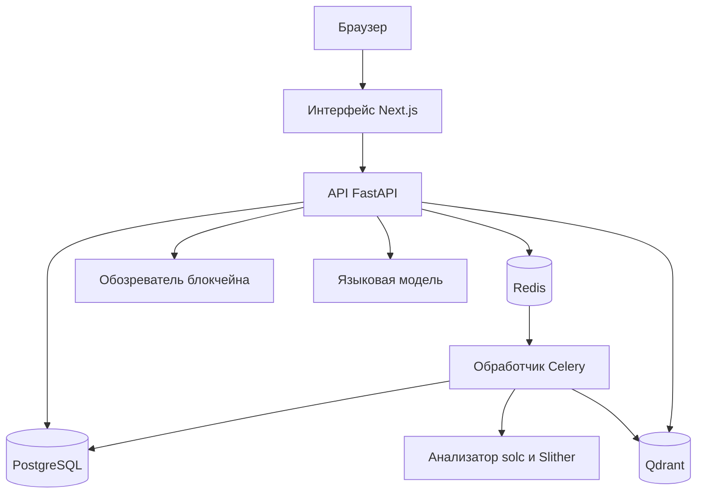

# Архитектура

## Схема сервисов

ChainWise — модульный монолит с отдельными процессами API, фонового обработчика, интерфейса и анализатора. API ставит задачи в Redis; Celery получает их из очереди. Языковую модель вызывает сервер при запросе к чату.

## Стек технологий

| Назначение | Технологии |
|---|---|
| Веб-интерфейс | Next.js 15, React 19, TypeScript, Tailwind CSS, Shadcn/ui, Framer Motion |
| Сервер | Python 3.12, FastAPI, Uvicorn, SQLAlchemy, Alembic |
| Фоновые задачи | Celery 5, Redis 7 |
| Хранение | PostgreSQL 15, Qdrant; расширение pgvector зарезервировано |
| Анализ | solc 0.8.24, Slither, XGBoost с эвристическим резервным расчётом |
| Поиск | FastEmbed, MiniLM ONNX, векторы размерности 384, BM25 |
| Отчёты | fpdf2 |
| Развёртывание | Docker Compose |

## Потоки данных

При загрузке API проверяет пользователя и исходники, сохраняет контракт с идентификатором попытки и публикует задачу. Обработчик запрашивает AST и отчёт Slither у анализатора, разбивает код по структуре, вычисляет векторы и сохраняет их в Qdrant. После расчёта оценки обработчик фиксирует состояние `ready` и успешное поколение анализа.

Чат проверяет готовность контракта, ищет фрагменты текущего поколения и формирует запрос языковой модели. Ответ возвращается как JSON или поток SSE с цитатами. Ответы кешируются в Redis и `analysis_reports`; история вопросов и ответов хранится отдельно в `chat_messages` и не передаётся модели.

## Границы модулей и транзакций

Маршруты API вызывают сервисы, которые работают с ORM и внешними интеграциями. Строгого слоя репозиториев нет: `contract_service.py` использует SQLAlchemy `Session`, создаёт `HTTPException` и импортирует задачу Celery.

`get_db` открывает сессию на запрос и закрывает её. Сервисы явно фиксируют или откатывают транзакции. Публикация задачи и запись в PostgreSQL не образуют общую транзакцию. Перед каждым изменением результатов обработчик блокирует строку контракта и проверяет идентификатор попытки. Устаревшая попытка не может опубликовать результат новой.

PostgreSQL и Qdrant также не имеют общей транзакции. Точки Qdrant разделены по UUID поколения; поиск использует только успешное поколение. Ключи обоих кешей ответов учитывают то же поколение. Сверка удаляет осиротевшие точки и устаревшие поколения. Подробности — в [жизненном цикле задач](./background-jobs.md).

## Состояние и восстановление

| Хранилище | Данные | Восстановление |
|---|---|---|
| PostgreSQL | Пользователи, исходники, результаты, поколения, отчёты, история чата | Основное долговечное состояние; обязательная резервная копия |
| Qdrant | Векторы и фрагменты кода по поколениям | Производные данные, необходимые для поиска; до проверки полного пересоздания требуется снимок |
| Redis | Очередь, блокировки, сеансы, счётчики, кеш ответов | Кеш можно пересоздать; потеря остальных данных может потребовать повторного входа и сверки зависших задач |

Согласованная точка восстановления включает PostgreSQL и Qdrant при остановленной записи. Порядок резервного копирования и проверки восстановления приведён в [руководстве эксплуатации](./operations.md#резервное-копирование-и-восстановление).

## Сборка Docker без сети

`make deps` заранее устанавливает зависимости на Linux x86_64 с Python 3.12 и Node.js 20+. Сборка образов использует `build.network: none`: сервер получает пакеты из `backend/.venv`, анализатор — из `slither/.venv`, интерфейс — из `frontend/node_modules`. solc и модель MiniLM также готовятся заранее.

## Порты и изоляция

| Сервис | Адрес на хосте |
|---|---|
| Интерфейс | `127.0.0.1:3001` |
| API | `127.0.0.1:8001` |
| PostgreSQL | `127.0.0.1:5432` |
| Redis | `127.0.0.1:6379` |
| Qdrant | `127.0.0.1:6333` |
| Анализатор | Не публикуется |

Сервисы используют DNS Compose. Анализатор подключён только к внутренней сети `analyzer`, общей с API и обработчиком. Он работает под UID 10001, без дополнительных прав Linux, с `no-new-privileges`, корневой файловой системой только для чтения и ограниченным tmpfs. Ограничены CPU, память и число процессов; учётные данные приложения не передаются. Версии solc выбираются из заранее установленного разрешённого списка.

Параметр `build.network: none` относится только к сборке. Сетевую изоляцию при работе задаёт сеть Compose. Docker снижает доступ и ресурсный ущерб, но не гарантирует защиту от выхода за границы контейнера.

## Ключевые компромиссы

- Сборка без сети требует заранее подготовленных артефактов той же платформы.
- Отдельный анализатор ограничивает выполнение недоверенного кода средствами контейнера.
- Qdrant добавляет специализированный поиск и второе хранилище без общей транзакции с PostgreSQL.
- Миграции при запуске API удобны локально, но требуют отдельного управляемого этапа при рабочем развёртывании.
- Совмещение очереди, сеансов, блокировок и кеша в Redis упрощает окружение и увеличивает последствия его отказа.
