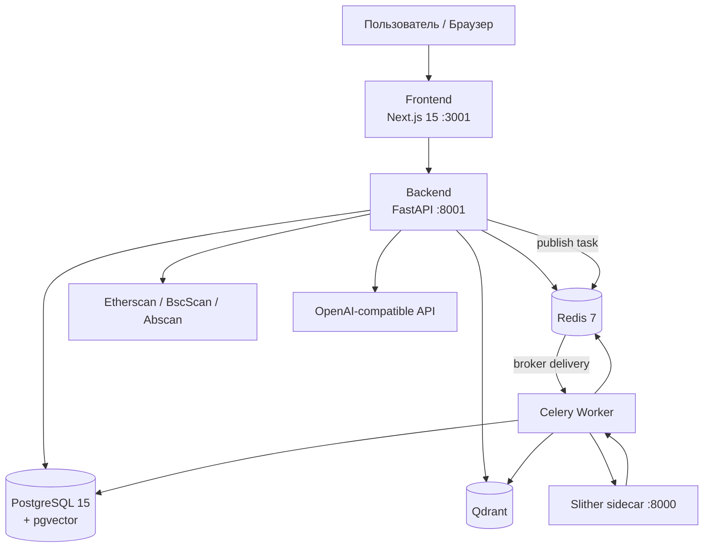

# Архитектура

## Схема сервисов



OpenAI-compatible API вызывается из backend при RAG-чате (`OPENAI_API_KEY`, при необходимости `OPENAI_BASE_URL` и `OPENAI_MODEL`). Celery worker не вызывается по HTTP: API публикует task в Redis broker.

## Архитектурный стиль и зависимости

ChainWise — контейнеризованный модульный монолит с отдельными процессами API, worker, frontend и Slither sidecar. Это не набор независимо развёртываемых бизнес-микросервисов и не формальная Clean/Hexagonal Architecture.

Типичное направление backend-зависимостей:

```text
api routers
  → services/orchestration
    → ORM models + integrations (Celery, Qdrant, Slither, OpenAI)
core dependencies/config/database
  → используются всеми слоями
```

Граница соблюдается не строго: `services/contract_service.py` создаёт FastAPI `HTTPException` и импортирует Celery task object. SQLAlchemy repositories как отдельный слой отсутствуют; services работают с `Session` напрямую.

## Стек технологий

| Слой | Технология | Версия | Назначение |
|---|---|---|---|
| Frontend | Next.js (App Router) | 15.x | UI |
| | React | 19.x | Компоненты |
| | TypeScript | 5.x | Типизация |
| | Tailwind CSS | 4.x | Стили |
| | Shadcn/ui | New York | Примитивы |
| | Framer Motion | 11.x | Анимации |
| Backend | Python | 3.12 | API |
| | FastAPI | 0.115+ | REST, OpenAPI |
| | Uvicorn | latest | ASGI |
| | SQLAlchemy | 2.x | ORM |
| | Alembic | 1.14+ | Миграции |
| AI / эмбеддинги | FastEmbed | `all-MiniLM-L6-v2` ONNX | 384d векторы |
| | Qdrant | latest | Векторный поиск |
| | OpenAI-compatible API | GPT-4o-mini по умолчанию | Генерация текста |
| Анализ | Slither | sidecar HTTP | Статический анализ JSON |
| | solc | 0.8.24+ через `py-solc-x` | Компиляция Solidity |
| | XGBoost | 2.x | Risk Score A/B/C/D |
| | fpdf2 | 2.8+ | PDF-отчёт без исходника |
| Фон | Celery | 5.x | Асинхронная индексация |
| | Redis | 7 | Брокер + lock индексации + кеш LLM |
| БД | PostgreSQL | 15 | Пользователи, контракты |
| | pgvector | 15 | Зарезервировано |
| Infra | Docker Compose | latest | Оркестрация |
| | GitHub Actions | `ci.yml` | flake8 + tsc + pytest + coverage на push |
| | Sentry | опционально | ошибки API / Celery / solc / Slither / LLM |

Backend-зависимости устанавливаются из `requirements.txt` через pip. Эмбеддинги вычисляются FastEmbed на ONNX, solc управляется через `py-solc-x`, а Slither запускается в отдельном контейнере. Sentry включается опционально через `SENTRY_DSN`; `/health` проверяет PostgreSQL, Redis, Qdrant и Slither.

## Поток данных

### 1. Загрузка и индексация (реализовано)

```
address/file → FastAPI (JWT) → Redis lock
  → Etherscan или parse .sol/.zip
  → PostgreSQL (status=indexing)
  → Celery task indexing.load_contract
      → solc compile → AST
      → Slither sidecar POST /analyze → slither_report
      → split by functions/modifiers
      → FastEmbed → Qdrant code_chunks
      → XGBoost risk_score A/B/C/D
      → status=ready (или failed + last_error)
  → GET /contracts/{id}/status (polling UI)
  → GET /contracts/{id}/report (PDF, без исходника)
```

### 2. RAG-чат (реализовано)

```
question → hybrid search (BM25 + vector)
  → prompt with chunks
  → OpenAI-compatible API (JSON или SSE)
  → answer + citations
  → cache (Redis + analysis_reports)
  → chat_messages (лента UI, не в LLM)
```

### Транзакции и согласованность

- FastAPI dependency `get_db` открывает SQLAlchemy session на запрос и только закрывает её; commit/rollback выполняют service-функции явно.
- Регистрация, создание контракта, присвоение `celery_task_id`, стадии индексации, кеш и чат используют отдельные commits.
- Worker коммитит AST, Slither report и `chunk_count` после каждой стадии. Финальный commit происходит через `set_indexing_step`.
- PostgreSQL и Qdrant не имеют общей транзакции. Upsert/delete в Qdrant может успешно завершиться до DB failure либо cleanup может не выполниться.
- LLM cache двухуровневый: Redis TTL 86400 секунд и долговечная таблица `analysis_reports`.

Подробности delivery semantics: [background-jobs.md](./background-jobs.md).

## Внешние границы

| Интеграция | Протокол | Вызывающий компонент |
|---|---|---|
| Explorer APIs | HTTPS, Etherscan-compatible | FastAPI analyze request |
| OpenAI-compatible API | HTTPS Chat Completions / stream | FastAPI chat request |
| Slither sidecar | HTTP JSON | Celery worker |
| Qdrant | HTTP client | worker и FastAPI RAG |
| PostgreSQL | SQLAlchemy/psycopg2 | FastAPI и worker |
| Redis | Redis protocol | FastAPI, Celery, worker |

Timeouts и retry неоднородны: LLM timeout 60 секунд, Slither subprocess 90 секунд; Celery task retry явно не настроен.

## Offline-сборка Docker

Образы backend, frontend и slither собираются **без интернета** (`build.network: none`):

| Сервис | Источник зависимостей |
|---|---|
| Backend | `backend/.venv/lib/python3.12/site-packages/` + `.solc` + `.models` |
| Slither | `slither/.venv/lib/python3.12/site-packages/` |
| Frontend | `frontend/node_modules/` |

Хост должен один раз выполнить `make deps` при наличии сети.

## Порты

| Сервис | Host | Container |
|---|---|---|
| Frontend | 3001 | 3000 |
| Backend | 8001 | 8000 |
| PostgreSQL | 5432 | 5432 |
| Redis | 6379 | 6379 |
| Qdrant | 6333 | 6333 |
| Slither | — | 8000 (внутренняя сеть Compose) |

## Ключевые trade-offs

- Offline build уменьшает зависимость сборки от сети, но требует host-артефакты той же платформы.
- Вынос Slither ограничивает subprocess отдельным контейнером, но Compose не задаёт resource/sandbox limits.
- Qdrant даёт специализированный vector search, но добавляет второе долговечное хранилище без transactional coupling.
- Автомиграция при startup упрощает локальный запуск, но не подходит для конкурентного production rollout.
- Redis объединяет broker, locks, sessions, limits и cache; это упрощает stack и расширяет blast radius сбоя.
