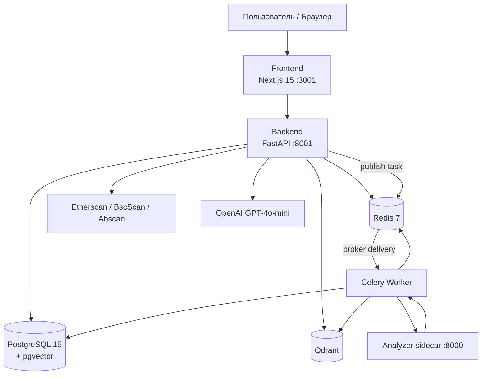

# Архитектура

## Схема сервисов



OpenAI-compatible API вызывается из backend при RAG-чате (`OPENAI_API_KEY`, при необходимости `OPENAI_BASE_URL` и `OPENAI_MODEL`). Celery worker не вызывается по HTTP: API публикует task в Redis broker.

## Архитектурный стиль и зависимости

ChainWise — контейнеризованный модульный монолит с отдельными процессами API, worker, frontend и analyzer sidecar. Это не набор независимо развёртываемых бизнес-микросервисов и не формальная Clean/Hexagonal Architecture.

Типичное направление backend-зависимостей:

```text
api routers
  → services/orchestration
    → ORM models + integrations (Celery, Qdrant, Slither, OpenAI)
core dependencies/config/database
  → используются всеми слоями
```

Граница соблюдается не строго: `services/contract_service.py` создаёт FastAPI `HTTPException` и импортирует Celery task object. SQLAlchemy repositories как отдельный слой отсутствуют; services работают с `Session` напрямую.

## Стек технологий

| Слой | Технология | Версия | Назначение |
|---|---|---|---|
| Frontend | Next.js (App Router) | 15.x | UI |
| | React | 19.x | Компоненты |
| | TypeScript | 5.x | Типизация |
| | Tailwind CSS | 4.x | Стили |
| | Shadcn/ui | New York | Примитивы |
| | Framer Motion | 11.x | Анимации |
| Backend | Python | 3.12 | API |
| | FastAPI | 0.115+ | REST, OpenAPI |
| | Uvicorn | latest | ASGI |
| | SQLAlchemy | 2.x | ORM |
| | Alembic | 1.14+ | Миграции |
| AI / эмбеддинги | FastEmbed | `all-MiniLM-L6-v2` ONNX | 384d векторы |
| | Qdrant | latest | Векторный поиск |
| | OpenAI | GPT-4o-mini / 4o | Генерация (фаза 5) |
| Анализ | solc + Slither | analyzer sidecar HTTP | AST + статический анализ JSON |
| | solc | allowlisted preinstalled versions, в analyzer | Компиляция Solidity |
| | XGBoost | 2.x | Experimental advisory pre-screening indicator A/B/C/D (synthetic labels) |
| | fpdf2 | 2.8+ | PDF-отчёт без исходника |
| Фон | Celery | 5.x | Асинхронная индексация |
| | Redis | 7 | Celery broker, locks, refresh sessions, limits и кеш LLM |
| БД | PostgreSQL | 15 | Пользователи, контракты |
| | pgvector | 15 | Зарезервировано |
| Infra | Docker Compose | latest | Оркестрация |
| | GitHub Actions | `ci.yml` | flake8 + tsc + pytest + coverage на push |
| | Sentry | опционально | ошибки API / Celery / solc / Slither / LLM |

Отклонения от исходного ТЗ: pip (`requirements.txt`) вместо Poetry; FastEmbed вместо Sentence-Transformers/PyTorch; `py-solc-x` используется только при подготовке preinstalled solc; solc и Slither запускаются отдельным analyzer-контейнером, не backend. Nginx / Prometheus не подключены. Sentry — опциональный `SENTRY_DSN`. `/health` уже проверяет postgres, redis, qdrant, analyzer.

## Поток данных

### 1. Загрузка и индексация (реализовано)

```
address/file → FastAPI (JWT) → Redis lock
  → Etherscan или parse .sol/.zip
  → PostgreSQL (status=indexing)
  → Celery task indexing.load_contract
      → analyzer POST /compile → AST
      → analyzer POST /analyze → slither_report
      → split by functions/modifiers
      → FastEmbed → Qdrant code_chunks
      → experimental advisory indicator A/B/C/D (XGBoost / heuristic)
      → status=ready (или failed + last_error)
  → GET /contracts/{id}/status (polling UI)
  → GET /contracts/{id}/report (PDF, без исходника)
```

### 2. RAG-чат (реализовано)

```
question → hybrid search (BM25 + vector)
  → prompt with chunks
  → OpenAI GPT-4o-mini (JSON или SSE)
  → answer + citations
  → cache (Redis + analysis_reports)
  → chat_messages (лента UI, не в LLM)
```

### Транзакции и согласованность

- FastAPI dependency `get_db` открывает SQLAlchemy session на запрос и только закрывает её; commit/rollback выполняют service-функции явно.
- Регистрация, создание контракта с attempt UUID, стадии индексации, кеш и чат используют отдельные commits.
- Worker делает atomic claim и проверяет attempt UUID под блокировкой строки перед записями AST, Slither report, `chunk_count` и `ready`.
- PostgreSQL и Qdrant не имеют общей транзакции. Qdrant points разделены по UUID поколения и поиск использует только поколение READY-ряда; failed/stale поколения остаются невидимыми.
- LLM cache использует Redis TTL 86400 секунд и таблицу `analysis_reports`; ключ обоих слоёв включает успешное поколение анализа.

## Классы состояния и восстановление

| Хранилище | Что содержит | Роль при восстановлении |
|---|---|---|
| PostgreSQL | Пользователи, исходники и результаты анализа, поколения, отчёты и история чата | Авторитетное долговечное состояние приложения; включать в обязательный backup |
| Qdrant `code_chunks` | Векторы и payload частей исходника по поколениям | Производное, но нужное для текущего RAG поиска состояние. Полной автоматической переиндексации в репозитории нет, поэтому до проверенного rebuild его нужно восстанавливать из snapshot |
| Redis | Celery queue/results, indexing locks, refresh-session keys, rate/quota counters и LLM response cache | Ответы в LLM cache можно потерять и пересоздать. Очередь, locks, sessions и counters — эфемерное операционное состояние: после потери Redis отложенные задачи могут потеряться, пользователям понадобится повторный вход, а reconciliation нужно выполнить по runbook |

Согласованная точка восстановления должна содержать PostgreSQL и Qdrant snapshot, сделанные при остановленной записи. Redis не является источником истины для контрактов или RAG-ответов. Практические backup и restore-verification шаги приведены в [operations](./operations.md#backup-и-recovery).

Подробности delivery semantics: [background-jobs.md](./background-jobs.md).

## Внешние границы

| Интеграция | Протокол | Вызывающий компонент |
|---|---|---|
| Explorer APIs | HTTPS, Etherscan-compatible | FastAPI analyze request |
| OpenAI-compatible API | HTTPS Chat Completions / stream | FastAPI chat request |
| Analyzer sidecar | HTTP JSON (`/compile`, `/analyze`) | Celery worker |
| Qdrant | HTTP client | worker и FastAPI RAG |
| PostgreSQL | SQLAlchemy/psycopg2 | FastAPI и worker |
| Redis | Redis protocol | FastAPI, Celery, worker |

Timeouts и retry неоднородны: LLM timeout 60 секунд, solc subprocess 45 секунд, Slither subprocess 90 секунд; Celery task retry явно не настроен.

## Offline-сборка Docker

Образы backend, frontend и slither собираются **без интернета** (`build.network: none`):

| Сервис | Источник зависимостей |
|---|---|
| Backend | `backend/.venv/lib/python3.12/site-packages/` + `.solc` + `.models` |
| Slither | `slither/.venv/lib/python3.12/site-packages/` |
| Frontend | `frontend/node_modules/` |

Хост должен один раз выполнить `make deps` при наличии сети.

## Порты

Все опубликованные host-порты привязаны к loopback (`127.0.0.1`); сервисы также общаются по Compose DNS внутри стандартной сети. Analyzer присоединён только к internal runtime-сети `analyzer`, общей с backend и worker. Sidecar работает под UID `10001`, с `no-new-privileges`, без capabilities, с read-only root, ограниченным tmpfs и CPU/RAM/PID limits; он не получает DB URL или application credentials. Скомпилировать можно только версии из `ALLOWED_SOLC_VERSIONS`, предустановленные в read-only `/opt/solc`. Эти настройки ограничивают поверхность доступа и ресурсы, но не гарантируют защиту от container escape или уязвимости ядра/runtime. Параметр Dockerfile `build.network: none` отключает сеть на этапе сборки и не задаёт runtime-изоляцию.

| Сервис | Host | Container |
|---|---|---|
| Frontend | 127.0.0.1:3001 | 3000 |
| Backend | 127.0.0.1:8001 | 8000 |
| PostgreSQL | 127.0.0.1:5432 | 5432 |
| Redis | 127.0.0.1:6379 | 6379 |
| Qdrant | 127.0.0.1:6333 | 6333 |
| Slither | — | 8000 (внутренняя сеть Compose) |

## Ключевые trade-offs

- Offline build уменьшает зависимость сборки от сети, но требует host-артефакты той же платформы.
- Вынос solc и Slither в analyzer ограничивает subprocess отдельным контейнером с runtime limits; Docker isolation не устраняет риски container escape.
- Qdrant даёт специализированный vector search, но добавляет второе долговечное хранилище без transactional coupling.
- Автомиграция при startup упрощает локальный запуск, но не подходит для конкурентного production rollout.
- Redis объединяет broker, locks, sessions, limits и cache; это упрощает stack и расширяет blast radius сбоя.
