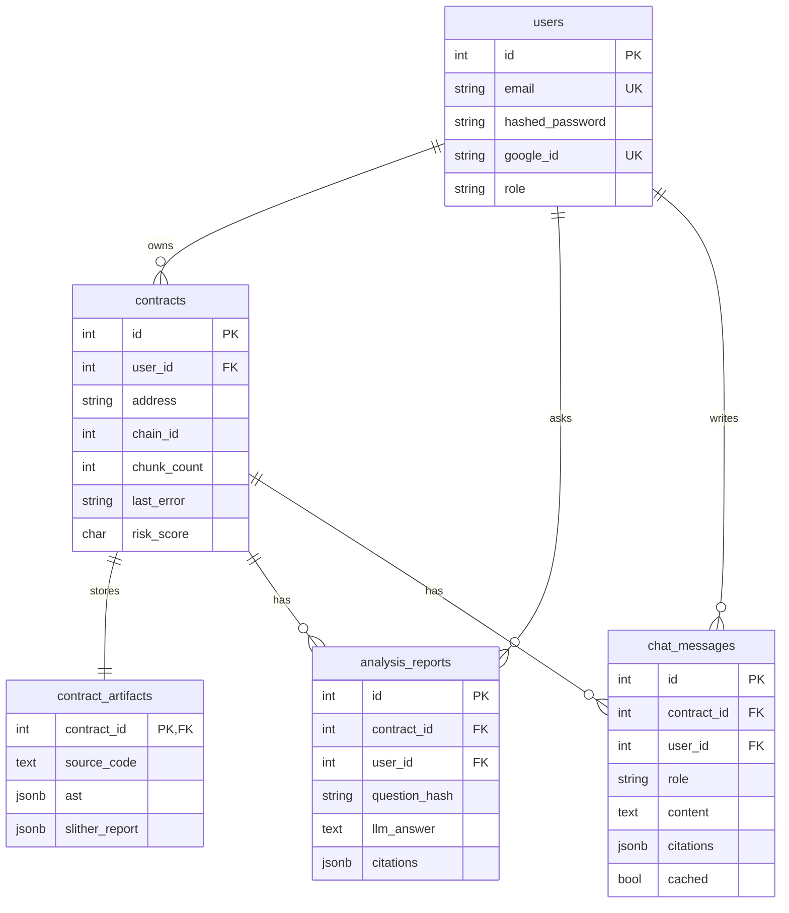

# База данных

## PostgreSQL 15 (+ pgvector)

Образ: `pgvector/pgvector:pg15`.

Миграции Alembic в `backend/alembic/versions/` применяются при старте backend (`alembic upgrade head`).

Расширение pgvector предоставляет выбранный image, но migrations не выполняют `CREATE EXTENSION vector`, а приложение не хранит embeddings в PostgreSQL. Все vectors находятся в Qdrant.

| Ревизия | Содержание |
|---|---|
| 001 | `users`, `contracts`, `analysis_reports` |
| 002 | `contracts.ast` |
| 003 | `contracts.chunk_count` |
| 004 | `contracts.last_error` |
| 005 | `analysis_reports.citations` + unique `(contract_id, question_hash)` |
| 006 | `chat_messages` — история чата пользователя по контракту |
| 007 | `contracts.risk_model`, `features_version` |
| 008 | Per-user ownership: `UNIQUE(user_id, address, chain_id)`, `user_id NOT NULL`, `ON DELETE CASCADE` |
| 009 | `contract_artifacts` (source/ast/slither); `contracts.indexing_step` |
| 010 | durable indexing attempt UUID, heartbeat/claim timestamps and stale-row index |
| 011 | `contracts.analysis_generation_id` identifies the last completed analysis generation |

### Таблица `users`

```sql
CREATE TABLE users (
    id SERIAL PRIMARY KEY,
    email VARCHAR(255) UNIQUE NOT NULL,
    hashed_password VARCHAR(255),
    google_id VARCHAR(255) UNIQUE,
    is_active BOOLEAN DEFAULT TRUE,
    created_at TIMESTAMP DEFAULT NOW(),
    role VARCHAR(20) DEFAULT 'user'   -- 'user' | 'admin'
);
```

### Таблица `contracts`

```sql
CREATE TABLE contracts (
    id SERIAL PRIMARY KEY,
    user_id INTEGER NOT NULL REFERENCES users(id) ON DELETE CASCADE,
    address VARCHAR(42) NOT NULL,
    chain_id INTEGER NOT NULL,
    name VARCHAR(255),
    compiler_version VARCHAR(20),
    is_verified BOOLEAN,
    status VARCHAR(20) DEFAULT 'pending',  -- pending | indexing | loaded | ready | failed
    indexing_step VARCHAR(32),             -- compile | slither | embed | score | done
    indexing_attempt_id VARCHAR(36),       -- UUID fencing this worker generation
    analysis_generation_id VARCHAR(36),     -- UUID of the last successfully published generation
    indexing_heartbeat_at TIMESTAMPTZ,     -- updated between pipeline steps
    indexing_claimed_at TIMESTAMPTZ,       -- atomic one-delivery claim
    celery_task_id VARCHAR(255),
    risk_score CHAR(1),                    -- A | B | C | D
    risk_model VARCHAR(20),
    features_version VARCHAR(32),
    chunk_count INTEGER,
    last_error TEXT,
    created_at TIMESTAMP DEFAULT NOW(),
    UNIQUE (user_id, address, chain_id)
);
```

Тяжёлые поля (`source_code`, `ast`, `slither_report`) вынесены в `contract_artifacts` (1:1, CASCADE). ORM-свойства `Contract.source_code` / `.ast` / `.slither_report` делегируют в artifact.

### Таблица `contract_artifacts`

```sql
CREATE TABLE contract_artifacts (
    contract_id INTEGER PRIMARY KEY REFERENCES contracts(id) ON DELETE CASCADE,
    source_code TEXT NOT NULL,
    ast JSONB,
    slither_report JSONB
);
```

### Таблица `analysis_reports`

Кеш ответов LLM. Ключ вопроса включает версию cache, `analysis_generation_id` и текст
вопроса; уникальность строки — `(contract_id, question_hash)`. Redis использует тот же
хеш в ключе. Поколение публикуется только вместе с переходом контракта в `ready`, поэтому
переиндексация читает отдельные Redis/DB cache entries и отдельные Qdrant chunks. Старые
записи не удаляются для корректности и не смешиваются с новым поколением. При миграции
готовых контрактов PR-06 поколение переносится из `indexing_attempt_id`.

```sql
CREATE TABLE analysis_reports (
    id SERIAL PRIMARY KEY,
    contract_id INTEGER REFERENCES contracts(id) ON DELETE CASCADE,
    user_id INTEGER REFERENCES users(id) ON DELETE SET NULL,
    question_hash VARCHAR(64) NOT NULL,    -- SHA256(question)
    llm_answer TEXT,
    citations JSONB,                       -- [{file_path, function_name, start_line, end_line, content}]
    tokens_used INTEGER,
    cost_usd DECIMAL(10, 6),
    created_at TIMESTAMP DEFAULT NOW(),
    UNIQUE (contract_id, question_hash)
);
```

Уникальность контрактов **per-user** по `(user_id, address, chain_id)`. Один on-chain адрес у двух пользователей — две независимые копии (и две индексации). Upload без on-chain адреса использует синтетический `0x` + SHA256.

История диалога в UI — отдельная таблица `chat_messages`. Кеш не является лентой: один и тот же вопрос может повторяться в чате, ключ кеша уникален.

### Таблица `chat_messages`

Лента чата текущего пользователя по контракту. Не передаётся в LLM.

```sql
CREATE TABLE chat_messages (
    id SERIAL PRIMARY KEY,
    contract_id INTEGER REFERENCES contracts(id) ON DELETE CASCADE,
    user_id INTEGER REFERENCES users(id) ON DELETE CASCADE,
    role VARCHAR(20) NOT NULL,             -- 'user' | 'assistant'
    content TEXT NOT NULL,
    citations JSONB,
    cached BOOLEAN DEFAULT FALSE,
    created_at TIMESTAMP DEFAULT NOW()
);
```

### Статус реализации

| Объект | Статус |
|---|---|
| Таблицы + Alembic | ✅ |
| SQLAlchemy модели | ✅ |
| Автомиграция при старте | ✅ |
| Запись `analysis_reports` | ✅ RAG |
| Запись `chat_messages` | ✅ лента чата |
| PDF-отчёт | ✅ генерируется из `contracts` + `slither_report`, отдельной таблицы нет |
| `risk_model` / `features_version` на контракте | ✅ колонки + поля status |

`UNIQUE(user_id, address, chain_id)` — идемпотентность загрузки **внутри аккаунта**; UI «уже разобран» только для своего ряда.

### Индексы и ограничения

- `users.email` — unique constraint и отдельный non-unique index, созданные migration 001;
- `users.google_id` — unique constraint;
- `contracts(user_id, address, chain_id)` — unique constraint migration 008;
- `contracts(status, indexing_heartbeat_at)` — stale indexing reconciliation migration 010;
- `analysis_reports(contract_id, question_hash)` — unique constraint;
- `analysis_reports.question_hash`, `chat_messages.contract_id`, `chat_messages.user_id` — indexes;
- `contract_artifacts.contract_id` — одновременно PK и FK.

Значения `status`, `role`, `risk_score` и `chat_messages.role` ограничены длиной колонок, но не CHECK/DB enum. Допустимые значения контролирует application code.

### Session и transaction boundaries

`core/deps.get_db` создаёт session на HTTP request и закрывает её без автоматического commit. Services коммитят явно. Создание контракта и публикация Celery-задачи не атомарны: row с attempt UUID и заранее сгенерированным `celery_task_id` сначала коммитится, затем task публикуется. Публикационная ошибка conditionally переводит только эту попытку в `failed`; если API погиб между DB commit и publish, её найдёт stale reconciler.

Worker атомарно claim-ит попытку и блокирует строку с проверкой UUID перед каждым commit. Qdrant не участвует в SQL-транзакции; его точки разделены по UUID поколения и читаются только по UUID READY-ряда. Подробности — [background-jobs.md](./background-jobs.md).

---

## Qdrant — коллекция `code_chunks`

Создаётся при первой индексации (`qdrant_indexer`).

| Поле | Тип | Описание |
|---|---|---|
| Vector | 384 dim | FastEmbed `all-MiniLM-L6-v2` |
| `contract_id` | int | FK на contracts |
| `file_path` | string | Путь к файлу |
| `function_name` | string | Имя функции/модификатора |
| `start_line` | int | Начало чанка |
| `end_line` | int | Конец чанка |
| `content` | text | Исходный код |

Точки разделяются по `contract_id` и `indexing_attempt_id`. Новый generation записывается отдельно; поисковые запросы фильтруют только `analysis_generation_id` контракта в `READY`, поэтому не смешивают поколения во время reindex. Неиспользуемые failed/stale generations автоматически не очищаются.

Dashboard: http://localhost:6333/dashboard

---

## Redis

| Key pattern | Назначение |
|---|---|
| `indexing_lock:{user_id}:{chain_id}:{address}` | Идемпотентность индексации per-user (TTL 3600 с) |
| `llm_cache:v6:{contract_id}:{question_hash}` | Кеш ответов LLM (TTL 86400 с) |
| `rl:analyze:{user_id}` / `rl:chat:{user_id}` | Rate limit (окно 60 с) |
| `quota:analyze:{user_id}:{YYYYMMDD}` / `quota:chat:...` | Дневные квоты |
| `refresh:{jti}` | Refresh JWT (TTL `REFRESH_TOKEN_EXPIRE_MINUTES`) |

Broker Celery: `CELERY_BROKER_URL` = Redis.

---

## ER-диаграмма


