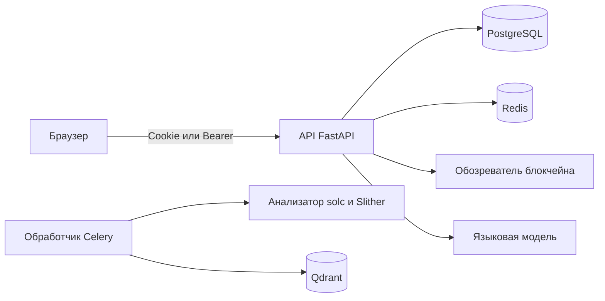

# Безопасность

Документ описывает механизмы защиты и границы доверия по коду проекта. Испытания на проникновение отдельно не проводились.

## Границы доверия

Исходный код контракта недоверенный. Обработчик передаёт его отдельному анализатору по HTTP. Только анализатор запускает solc и Slither. Размеры запросов, ответов и вывода процессов ограничены; у процессов есть предельное время выполнения.

Compose запускает анализатор от непривилегированного пользователя, с корневой файловой системой только для чтения, ограниченным tmpfs, без дополнительных прав Linux и с `no-new-privileges`. Ограничены CPU, память и число процессов. Внутренняя сеть не даёт анализатору внешнего доступа; адрес БД и учётные данные приложения не передаются. Разрешены только заранее установленные версии solc. Точные пределы приведены в [эксплуатации](./operations.md#сеть-и-публичный-https-вход).

## Аутентификация

- Пароли хешируются через passlib и bcrypt.
- JWT доступа содержит `sub`, `role`, `exp`, `typ=access`; JWT обновления дополнительно содержит `jti`.
- Токен доступа принимается из `Authorization: Bearer` либо cookie `cw_access` с HttpOnly.
- Токен обновления принимается только из cookie `cw_refresh` с HttpOnly. Активный `jti` хранится в Redis под ключом `refresh:{jti}`; обновление удаляет прежний ключ и выдаёт новую пару токенов.
- Вход через Google проверяет токен библиотекой `google-auth` и сравнивает целевое приложение с `GOOGLE_CLIENT_ID`.

Значение `SECRET_KEY` по умолчанию предназначено только для разработки. При `ENVIRONMENT=production` слабые значения и заглушки отклоняются до запуска приложения. Алгоритм подписи `ALGORITHM` следует оставлять `HS256`, если другой вариант отдельно не проверен.

## Cookie, CSRF и CORS

Cookie имеют HttpOnly и `Path=/`. Параметры `Secure` и `SameSite` задаются через `COOKIE_SECURE` и `COOKIE_SAMESITE`; для `SameSite=None` код включает `Secure`.

Для изменяющего запроса с cookie без Bearer `CsrfCookieMiddleware` требует заголовок `X-Requested-With`. Регистрация и вход, включая Google, исключены. Проверяется наличие заголовка, а не CSRF-токен. Защита опирается на предварительную проверку браузера и точный список разрешённых источников CORS.

`CORS_ORIGINS` — список адресов через запятую. Включён `allow_credentials=True`, методы и заголовки разрешены через `*`. В рабочей среде допускайте только доверенные источники.

## Авторизация и владение данными

`get_current_user` отклоняет отсутствующий, истёкший или неподходящий токен и неактивного пользователя. `get_contract_for_user` отвечает `404` на чужой контракт, не раскрывая его существование. Администратор может читать и удалять все контракты; список для него включает последние 50 записей всех пользователей.

Уникальность `(user_id, address, chain_id)` разделяет копии одного адреса разных пользователей. Поиск Qdrant ограничен внутренним `contract_id` и успешным поколением анализа.

## Загрузка и обработка исходника

До разбора multipart прослойка ASGI ограничивает тело HTTP-запроса размером 10 МиБ + 256 КиБ, в том числе без `Content-Length`. Превышение возвращает `413`. Затем `UploadFile` читается блоками по 64 КиБ; `.sol` и `.zip` ограничены 10 МиБ.

Разрешены только `.sol` и `.zip` с текстом UTF-8. Архив не извлекается на диск. Допускается до 100 записей, до 10 МиБ на файл и до 25 МиБ фактически прочитанного распакованного кода. Проверяются нормализованные пути, дубликаты, кодировка, тип и способ сжатия. Абсолютные пути, выход за каталог и шифрованные записи запрещены. Анализатор повторно проверяет пути и версию компилятора; загрузки бинарников во время запроса нет.

## Секреты и чувствительные данные

`.env` исключён из Git. Не публикуйте `POSTGRES_PASSWORD`, `SECRET_KEY`, `OPENAI_API_KEY`, `ETHERSCAN_API_KEY`, `QDRANT_API_KEY` и DSN Sentry.

Форматирование журналов скрывает известные чувствительные поля и длинные сообщения, похожие на исходники. Sentry настроен с `send_default_pii=False`; тела запросов и заголовки авторизации скрываются. Для новых полей обновляйте `SENSITIVE_KEYS`; это не гарантирует отсутствия всех возможных утечек.

Исходники, результаты и диалоги сохраняются в PostgreSQL, фрагменты кода — в Qdrant. Шифрование на диске и сроки хранения отдельно не настроены.

## Ограничение частоты запросов и квоты

Ограничения используют счётчики Redis. При ошибке Redis запросы продолжают обрабатываться без этих ограничений. Максимум контрактов проверяется через `COUNT` до вставки; отдельной транзакционной блокировки нет, поэтому параллельные запросы могут превысить квоту.

## Подтверждённые ограничения

- TLS, обратный прокси и защитные HTTP-заголовки требуют настройки; см. [публичный HTTPS-вход](./operations.md#public-https-entrypoint).
- Восстановление пароля, проверка почты и многофакторная аутентификация отсутствуют. Пароль ограничен длиной 8–128 символов.
- Настройки рабочей среды проверяются до запуска; дополнительная конфигурация Compose убирает `--reload`.
- Порты привязаны к `127.0.0.1`; не публикуйте хранилища через `0.0.0.0`.
- Контейнерные ограничения не гарантируют защиту от выхода за границы контейнера и уязвимостей ядра. Отдельного профиля seccomp и автоматического сканирования уязвимостей нет.
- Перед публичным развёртыванием выполните [условия выпуска](./operations.md#условия-выпуска-в-рабочую-среду).
