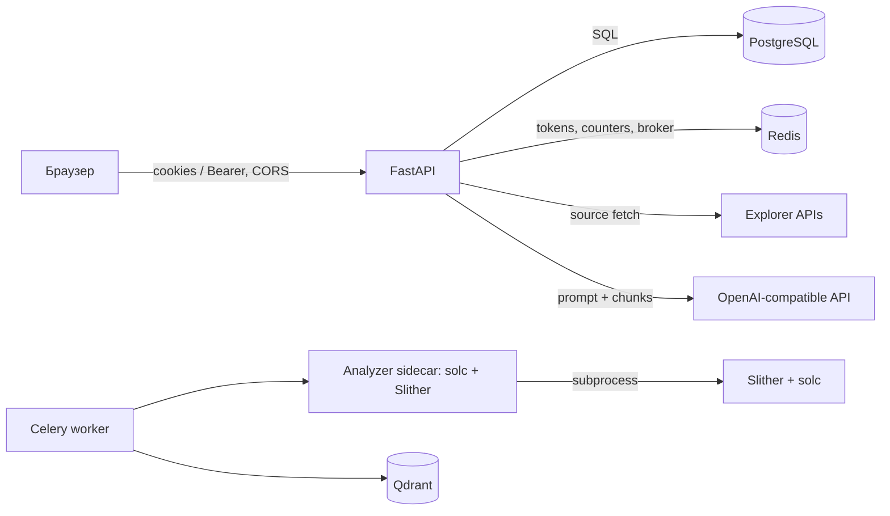

# Безопасность

Документ описывает подтверждённые механизмы и границы доверия. Он не является отчётом о penetration testing.

## Границы доверия

Исходный код контракта недоверенный. Celery worker передаёт его analyzer sidecar по HTTP; только sidecar запускает solc и Slither. Запросы и ответы ограничены по размеру, у дочерних процессов есть таймаут и лимиты stdout/stderr. Compose запускает analyzer non-root с read-only root filesystem, ограниченным `/tmp` tmpfs, `no-new-privileges`, без capabilities и с CPU/RAM/PID limits. Sidecar находится в internal-сети, не получает DB URL или прикладных credentials и может запускать только preinstalled версии из `ALLOWED_SOLC_VERSIONS`.

## Аутентификация

- Пароли хешируются `passlib`/bcrypt (`core/security.py`).
- Access JWT содержит `sub`, `role`, `exp`, `typ=access`; refresh JWT дополнительно содержит `jti`.
- Access принимается из `Authorization: Bearer` либо HttpOnly cookie `cw_access`.
- Refresh принимается только из HttpOnly cookie `cw_refresh`; активный `jti` хранится в Redis как `refresh:{jti}`.
- При refresh старый Redis-ключ удаляется и выдаётся новая пара токенов.
- Google flow проверяет ID token библиотекой `google-auth` и audience `GOOGLE_CLIENT_ID`.

`SECRET_KEY` имеет небезопасное development-значение по умолчанию. При `ENVIRONMENT=production` Settings отвергают placeholder/слабый ключ до запуска приложения. Настраиваемый `ALGORITHM` передаётся в encode/decode, поэтому допустимый алгоритм следует фиксировать на `HS256`, если иной вариант не был отдельно проверен.

## Cookies, CSRF и CORS

Cookies всегда `HttpOnly`, имеют `Path=/`; `Secure` и `SameSite` задаются `COOKIE_SECURE` и `COOKIE_SAMESITE`. Для `SameSite=None` код принудительно включает `Secure`.

`CsrfCookieMiddleware` требует наличие заголовка `X-Requested-With` у mutating-запроса, если запрос использует cookie и не содержит Bearer header. Register, login и Google login исключены. Механизм проверяет только наличие заголовка, не CSRF token. Его защита опирается на browser preflight и точный CORS allowlist.

`CORS_ORIGINS` разбирается как CSV. `allow_credentials=True`; методы и заголовки разрешены `*`. В production нельзя использовать недоверенные origins.

## Авторизация и владение данными

`get_current_user` отклоняет отсутствующий, истёкший и refresh JWT, а также inactive user. `get_contract_for_user` возвращает `404` для чужого контракта, чтобы не подтверждать его существование. Пользователь с ролью `admin` может читать и удалять любые контракты; `GET /contracts` также возвращает ему последние 50 контрактов всех пользователей.

Ограничение PostgreSQL `UNIQUE(user_id, address, chain_id)` отделяет копии одного адреса разных пользователей. Qdrant payload фильтруется по внутреннему `contract_id`.

## Загрузка и обработка исходника

- До разбора multipart внешний ASGI middleware ограничивает полный HTTP body upload-запроса 10 MiB + 256 KiB, включая chunked запросы без `Content-Length`; при превышении возвращается `413`, не позволяя Starlette бесконечно spool-ить крупные тела во временные файлы. Маршрут затем читает `UploadFile` блоками по 64 KiB и ограничивает сам `.sol` или `.zip` до 10 MiB.
- Принимаются только `.sol` и `.zip`, текст декодируется как UTF-8.
- ZIP не извлекается на диск. Число записей ограничено 100, размер одного `.sol` — 10 MiB, суммарный фактически прочитанный распакованный Solidity-код — 25 MiB. Чтение записей идёт блоками с проверкой фактического объёма; проверяются нормализованные пути, дубликаты, UTF-8, тип и метод сжатия. Абсолютные пути, выход за каталог и зашифрованные записи запрещены.
- В analyzer sidecar `_safe_path` отклоняет `..` и выход из временного каталога.
- Версия solc должна соответствовать `N.N.N`, входить в `ALLOWED_SOLC_VERSIONS` и быть заранее установлена в `/opt/solc`; скачивания при обработке запроса нет.

## Секреты и чувствительные данные

Секреты поступают из окружения; `.env` исключён из Git и не должен публиковаться. К секретам относятся `POSTGRES_PASSWORD`, `SECRET_KEY`, `OPENAI_API_KEY`, `ETHERSCAN_API_KEY`, `QDRANT_API_KEY` и Sentry DSN.

JSON formatter редактирует известные ключи (`source_code`, `question`, `answer`, tokens и др.) и длинные сообщения, похожие на исходник. Sentry работает с `send_default_pii=False`, не отправляет request body и редактирует auth headers. Это defense-in-depth, а не доказательство отсутствия всех утечек: новые поля нужно добавлять в `SENSITIVE_KEYS`.

Исходники, AST, Slither report, вопросы и ответы сохраняются в PostgreSQL; чанки исходника — в Qdrant. Шифрование данных на диске и retention policy репозиторием не настроены.

## Rate limits и квоты

Rate limits и дневные квоты используют Redis fixed counters. При ошибке Redis они fail open. Максимум контрактов проверяется запросом `COUNT` перед insert и не защищён отдельной транзакционной блокировкой, поэтому параллельные запросы могут превысить лимит.

## Подтверждённые ограничения

- TLS, reverse proxy и security headers не входят в Compose stack; публичный HTTPS-вход описан в [operations](./operations.md#public-https-entrypoint).
- Нет reset/verify email, MFA, password policy кроме длины 8–128.
- Production Settings fail fast при небезопасном ключе/пароле, cookies, origins или access-token lifetime; production Compose overlay снимает `--reload`.
- Compose публикует frontend, backend и data services только на `127.0.0.1`; не меняйте bindings на `0.0.0.0` для публичного доступа.
- Docker runtime limits уменьшают доступ и ресурсный ущерб, но не гарантируют защиту от container escape или уязвимостей ядра/runtime. Отдельного seccomp-профиля и vulnerability scanning в CI нет.
- Production deployment заблокирован до выполнения [release gate](./operations.md#production-release-gate): текущий overlay наследует bind mounts, использует mutable image tags и не отделяет миграции от API startup. CI не формирует SBOM и не сканирует зависимости или images.

