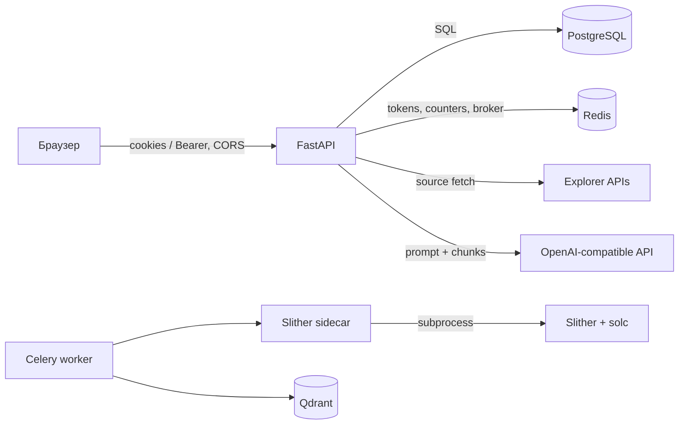

# Безопасность

Документ описывает подтверждённые механизмы и границы доверия. Он не является отчётом о penetration testing.

## Границы доверия

Исходный код контракта недоверенный. Он передаётся в solc и Slither sidecar; sidecar запускает Slither subprocess с timeout 90 секунд во временном каталоге. Репозиторий не задаёт для контейнера отдельные `read_only`, seccomp, CPU или memory limits.

## Аутентификация

- Пароли хешируются `passlib`/bcrypt (`core/security.py`).
- Access JWT содержит `sub`, `role`, `exp`, `typ=access`; refresh JWT дополнительно содержит `jti`.
- Access принимается из `Authorization: Bearer` либо HttpOnly cookie `cw_access`.
- Refresh принимается только из HttpOnly cookie `cw_refresh`; активный `jti` хранится в Redis как `refresh:{jti}`.
- При refresh старый Redis-ключ удаляется и выдаётся новая пара токенов.
- Google flow проверяет ID token библиотекой `google-auth` и audience `GOOGLE_CLIENT_ID`.

`SECRET_KEY` имеет небезопасное development-значение по умолчанию. Код не запрещает запуск production с этим значением; оператор обязан заменить его. Настраиваемый `ALGORITHM` передаётся в encode/decode, поэтому допустимый алгоритм следует фиксировать на `HS256`, если иной вариант не был отдельно проверен.

## Cookies, CSRF и CORS

Cookies всегда `HttpOnly`, имеют `Path=/`; `Secure` и `SameSite` задаются `COOKIE_SECURE` и `COOKIE_SAMESITE`. Для `SameSite=None` код принудительно включает `Secure`.

`CsrfCookieMiddleware` требует наличие заголовка `X-Requested-With` у mutating-запроса, если запрос использует cookie и не содержит Bearer header. Register, login и Google login исключены. Механизм проверяет только наличие заголовка, не CSRF token. Его защита опирается на browser preflight и точный CORS allowlist.

`CORS_ORIGINS` разбирается как CSV. `allow_credentials=True`; методы и заголовки разрешены `*`. В production нельзя использовать недоверенные origins.

## Авторизация и владение данными

`get_current_user` отклоняет отсутствующий, истёкший и refresh JWT, а также inactive user. `get_contract_for_user` возвращает `404` для чужого контракта, чтобы не подтверждать его существование. Пользователь с ролью `admin` может читать и удалять любые контракты; `GET /contracts` также возвращает ему последние 50 контрактов всех пользователей.

Ограничение PostgreSQL `UNIQUE(user_id, address, chain_id)` отделяет копии одного адреса разных пользователей. Qdrant payload фильтруется по внутреннему `contract_id`.

## Загрузка и обработка исходника

- API ограничивает входной архив или файл 10 MiB до распаковки.
- Принимаются только `.sol` и `.zip`, текст декодируется как UTF-8.
- ZIP читается в памяти. Ограничения на суммарный распакованный размер, число entries и compression ratio отсутствуют.
- Имена файлов не извлекаются на диск в backend. В Slither sidecar `_safe_path` отклоняет `..` и выход из временного каталога.
- Версия solc должна соответствовать `N.N.N`, а бинарник уже должен существовать в `/opt/solc`.

## Секреты и чувствительные данные

Секреты поступают из окружения; `.env` исключён из Git и не должен публиковаться. К секретам относятся `POSTGRES_PASSWORD`, `SECRET_KEY`, `OPENAI_API_KEY`, `ETHERSCAN_API_KEY`, `QDRANT_API_KEY` и Sentry DSN.

JSON formatter редактирует известные ключи (`source_code`, `question`, `answer`, tokens и др.) и длинные сообщения, похожие на исходник. Sentry работает с `send_default_pii=False`, не отправляет request body и редактирует auth headers. Это defense-in-depth, а не доказательство отсутствия всех утечек: новые поля нужно добавлять в `SENSITIVE_KEYS`.

Исходники, AST, Slither report, вопросы и ответы сохраняются в PostgreSQL; чанки исходника — в Qdrant. Шифрование данных на диске и retention policy репозиторием не настроены.

## Rate limits и квоты

Rate limits и дневные квоты используют Redis fixed counters. При ошибке Redis они fail open. Максимум контрактов проверяется запросом `COUNT` перед insert и не защищён отдельной транзакционной блокировкой, поэтому параллельные запросы могут превысить лимит.

## Подтверждённые ограничения

- TLS, reverse proxy и security headers не настроены.
- Нет reset/verify email, MFA, password policy кроме длины 8–128.
- Нет принудительной проверки безопасных production settings при старте.
- Compose публикует PostgreSQL, Redis и Qdrant на всех host interfaces по стандартным портам.
- Контейнерные sandbox limits и vulnerability scanning в CI отсутствуют.
- ZIP decompression bomb protection отсутствует.

